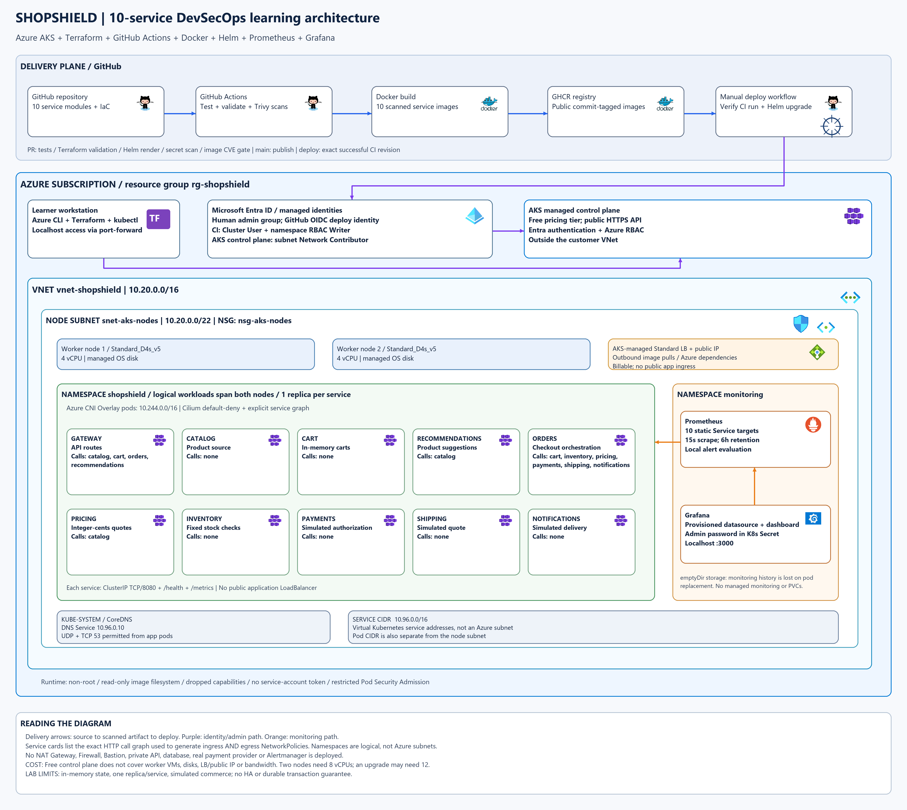

# ShopShield application

This directory contains actual Python source for ten HTTP microservices. Python 3.12 or newer is sufficient; there are no third-party packages to install.

## Check the application

From this directory, run:

```shell
python tests/integration.py
```

The test starts all ten services, checks their HTTP interactions, and stops them afterward. Expected result:

```text
PASS: ten-service checkout, idempotency, decline, validation, stock, metrics
```

## Run it yourself

```shell
python run_local.py
```

Keep that terminal open. Open http://127.0.0.1:8080/products or http://127.0.0.1:8080/recommendations in a browser to see JSON responses. This application has an API, with no storefront UI. Stop all services with Ctrl+C.

| Service | Local port | Code |
|---|---|---|
| Gateway | 8080 | `services/gateway.py` |
| Catalog | 8081 | `services/catalog.py` |
| Cart | 8082 | `services/cart.py` |
| Pricing | 8083 | `services/pricing.py` |
| Inventory | 8084 | `services/inventory.py` |
| Orders | 8085 | `services/orders.py` |
| Payments | 8086 | `services/payments.py` |
| Shipping | 8087 | `services/shipping.py` |
| Notifications | 8088 | `services/notifications.py` |
| Recommendations | 8089 | `services/recommendations.py` |

Every service exposes `/health` and `/metrics`. The local launcher supplies service addresses through environment variables and binds them to loopback. The later container setup gives each service its own container listening on port 8080.

## Try checkout in PowerShell

Open another PowerShell terminal while the local launcher is running:

```powershell
$cartBody = @{
    cart_id = 'demo'
    items = @(@{ sku = 'book'; qty = 2 })
} | ConvertTo-Json -Depth 4

Invoke-RestMethod -Method Post -Uri 'http://127.0.0.1:8080/cart' `
    -ContentType 'application/json' -Body $cartBody

$checkoutBody = @{
    cart_id = 'demo'
    country = 'IN'
    token = 'demo-approved'
} | ConvertTo-Json

Invoke-RestMethod -Method Post -Uri 'http://127.0.0.1:8080/checkout' `
    -ContentType 'application/json' -Body $checkoutBody `
    -Headers @{ 'Idempotency-Key' = 'my-first-order' }
```

Expected total: 3500 cents. Repeat the same checkout with the same key: it returns the same order ID. Use a new key and token `demo-declined` to exercise a simulated rejection.

Payments and notifications are simulations. Carts and orders live in memory; stopping or replacing those services loses their data. Inventory checks fixed demonstration stock and does not reserve it. Keep one replica per service for this implementation.

## Docker and the next learning stages

The `Dockerfile`, `.dockerignore`, `.gitignore`, and `compose.yaml` are now included. Follow [the Docker guide](docs/03-docker.md) to build and run the services. Its `COPY common.py` and `COPY services/${SERVICE}.py` instructions now have real source files to copy. Stop the local launcher before publishing the Compose gateway on port 8080.

Continue through the [remaining DevSecOps guides](docs/README.md) from this application directory as your project root.

## Architecture



Terraform, Helm, CI/CD and monitoring implementation instructions are in `docs/`; create those files as you progress through the lessons. Their live Azure deployment has not yet been verified.
